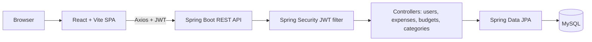

# Sampada

[](https://sampada.amithshankar.in)

Sampada (Sanskrit for wealth) is a personal expense tracker. You log expenses, set a monthly budget per category and see where the money went over the last 1, 3, 6 or 12 months. I built it to work through a complete React and Spring Boot stack on my own: JWT auth, a relational schema, paginated APIs and a dashboard that stays in sync with the server through TanStack Query.

## Features

- **Dashboard:** this month's totals, a 6-month spending trend, the current month's category split, budget progress and recent transactions.
- **Expenses:** a TanStack Table with server-side pagination, sorting and filters for category, payment method, date and amount. Add, edit and delete.
- **Analytics:** pick 1, 3, 6 or 12 months to see total, average, highest and lowest spend, a trend line, a category pie and a payment-method bar chart.
- **Budgets:** a monthly limit per category with progress against current spend and an On Track / Near Limit / Over Budget status. Budgets and expenses load in parallel with `useQueries`.
- **Categories:** custom categories with their own colour and icon.
- **Currency display:** INR, USD, EUR or GBP.
- **Account:** sign up, log in, password reset, profile and avatar updates.
- **Light and dark themes.**

## Architecture



The API has 4 controllers and 19 endpoints. Routes under `/auth` are open; the expenses, budgets and categories routes need a valid JWT, checked by a filter in front of Spring Security. On the frontend, Zustand holds UI state and the signed-in user, and TanStack Query owns server data and refetching.

If the API cannot be reached, the frontend falls back to bundled demo data, which is how the live site runs without a hosted backend.

## Stack

| Layer | Tools |
| :--- | :--- |
| Frontend | React 18, Vite, TypeScript, Tailwind CSS, Shadcn UI, TanStack Query, TanStack Table, Zustand, React Hook Form, Zod, Recharts, Axios |
| Backend | Java 17, Spring Boot 3.3, Spring Security, JWT (jjwt), Spring Data JPA, Bean Validation, Maven |
| Database | MySQL |
| Hosting | Vercel (frontend) |

## Local setup

Requirements: Node.js 18+, pnpm, Java 17, MySQL.

### Database

```bash
mysql -u root -p -e "CREATE DATABASE expensetracker"
mysql -u root -p expensetracker < Database/SampadaDB.sql
```

### Backend

Create the folder `BackEnd/src/main/resources` and, inside it, an `application.properties` file with the properties listed under Environment variables. Then:

```bash
cd BackEnd
./mvnw spring-boot:run          # Windows: mvnw.cmd spring-boot:run
```

The API listens on port 8080.

### Frontend

```bash
cd FrontEnd
pnpm install                    # creates pnpm-lock.yaml; the repo currently ships package-lock.json
pnpm dev                        # http://localhost:5173
```

The frontend calls the API on port 8080 of the same hostname it is served from.

## Environment variables

The backend reads these properties from `application.properties` (not committed):

| Property | Purpose |
| :--- | :--- |
| `spring.datasource.url` | JDBC URL, for example `jdbc:mysql://localhost:3306/expensetracker` |
| `spring.datasource.username`, `spring.datasource.password` | MySQL credentials |
| `jwt.secret` | JWT signing key (256-bit) |
| `jwt.expiration` | Token lifetime in milliseconds |

The frontend needs no environment variables.

## Tests

There are no automated tests yet. Adding them is the first item under Next steps.

## Deployment

The frontend is built with `pnpm build` and hosted on Vercel at [sampada.amithshankar.in](https://sampada.amithshankar.in). The backend is not hosted, so the live site shows demo data.

## Next steps

- Tests: Vitest and Testing Library for the dashboard, budgets and expense table; JUnit and MockMvc for the controllers and the JWT filter.
- CSV and Excel import and export for expenses.
- A "Smart Insight" card on the dashboard that calls out unusual spending.

## License

MIT
